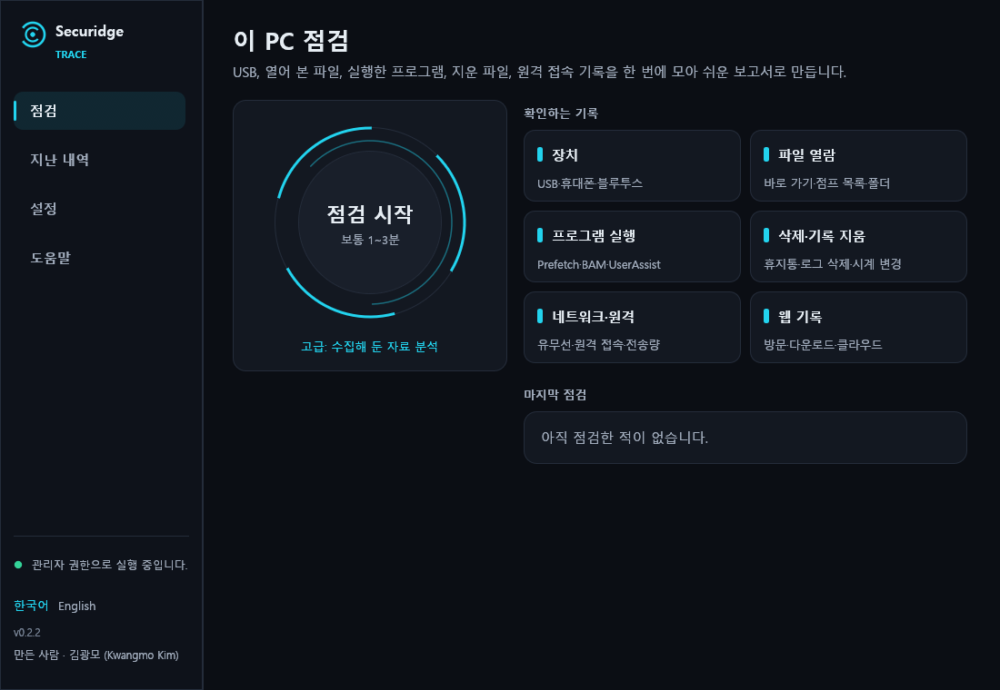
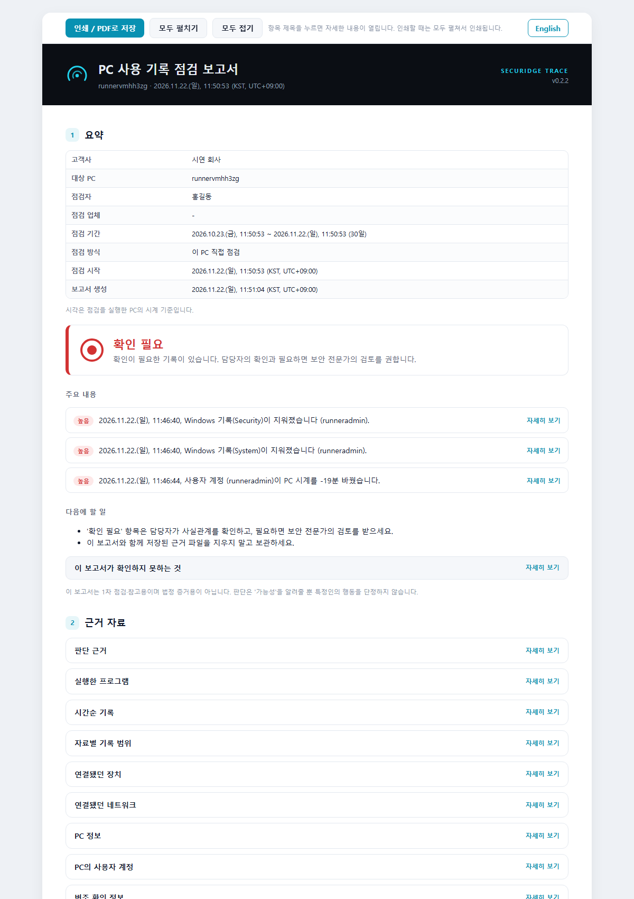

# Securidge Trace

[English](README.md) · **한국어**

**[⬇ 최신 버전 내려받기 (Windows, zip)](https://github.com/securidge/securidge-trace/releases/latest/download/SecuridgeTrace-windows-x64.zip)** · 만든 사람: 김광모 (Kwangmo Kim)

Windows PC에 남은 사용 기록을 모아 **누구나 한눈에 이해할 수 있는 보고서**로 만드는 무료 점검 도구.
연결됐던 USB·스마트폰·블루투스, 열어 본 파일과 폴더, 실행한 프로그램, 지운 파일, 네트워크·원격 접속·전송량,
웹 방문·다운로드, 로그 삭제·시계 변경을 읽고, 판단 규칙에 따라
"특이사항 미발견 / 주의 / 확인 필요 / 판단 불가"로 정리한다. 설치 없이 실행한다. 한국어·영어.



<details><summary>보고서 예시</summary>



</details>

## 내려받기

[최신 버전 zip](https://github.com/securidge/securidge-trace/releases/latest/download/SecuridgeTrace-windows-x64.zip)을 받거나 [Releases](../../releases/latest)에서 받아 압축을 풀고
`SecuridgeTrace.exe`를 실행한다. 사용법은 zip 안의 `사용안내.txt` (영어: `Guide-EN.txt`).

- 변조 확인: zip과 함께 올린 `.sha256` 파일의 값과 비교한다 (`Get-FileHash 파일.zip -Algorithm SHA256`).
- 코드 서명을 하지 않았으므로 처음 실행할 때 "Windows의 PC 보호" 창이 뜰 수 있다. [추가 정보] → [실행].

## 무엇을 읽는가

| 자료 | 읽는 것 | 이 PC 점검에서 읽는 방법 |
|---|---|---|
| SYSTEM 하이브 | 컴퓨터 이름, 시간대, USB 저장장치(최초·마지막 연결, 분리), 휴대 장치, 블루투스, 드라이브 문자, **BAM**(사용자별 프로그램 마지막 실행) | `reg save`, 트랜잭션 로그 적용 |
| SOFTWARE 하이브 | Windows 버전, 계정(SID ↔ 이름), 네트워크(유선·무선, 최초·마지막 연결) | `reg save` |
| 사용자 하이브 (NTUSER, UsrClass) | **UserAssist**(탐색기로 실행한 프로그램·횟수), **ShellBags**(열어 본 폴더: USB·네트워크·휴대폰 포함) | 로그온 사용자: `reg save HKU\<SID>`, 그 밖: 직접 읽기 |
| **Amcache.hve** | PC에 있었던 실행 파일의 경로·SHA-1 | `esentutl /y /vss` (섀도 복사본) |
| **Prefetch** | 실행한 프로그램, 실행 횟수, 최근 8번 실행 시각, 실행 파일이 있던 볼륨 일련번호 (Windows 7~11, 압축 형식 포함) | 직접 읽기 |
| **SRUM** | 프로그램별 하루 네트워크 전송량 (약 한 달) | `esentutl /y /vss` |
| 이벤트 로그 | 로그 삭제(1102·104), 시계 변경(4616·Kernel-General 1), 저장장치 연결(1006), 무선 연결(8001·8003), **원격 데스크톱**(4624 유형 10, 21·24·25, 1149) | `wevtutil epl` |
| 바로 가기(LNK), **점프 목록** | 열어 본 파일, 볼륨 일련번호, 드라이브 종류, 프로그램별 사용 횟수 | 직접 읽기 |
| 휴지통 `$I` | 지운 파일의 원래 경로·크기·시각·계정 | 직접 읽기 |
| 브라우저 | Chrome·Edge·Whale·Brave·Vivaldi 방문·다운로드, Firefox 방문 | 사본을 만들어 읽기 |

판단 규칙: R1 처음 보는 저장장치, R2 업무 시간 외 저장장치, R3 이동식 저장장치의 파일 열람(볼륨 일련번호로 장치와 연결),
R4 대량 삭제, R5 로그 삭제, R6 사람이 바꾼 시계, R7 휴대 장치, R8 클라우드·웹메일 접속,
R9 이동식 저장장치에서 실행한 프로그램, R10 흔적 지우기 프로그램 실행, R11 원격 데스크톱 접속,
R12 하루 전송량이 많은 프로그램, R13 원격 제어 프로그램 실행.
보고서는 한국어·영어 두 가지로 함께 만들어지고(보고서 위 버튼으로 전환), 세부 항목은 [자세히 보기]로 펼친다.
등록한 장치와 점검 도구가 담긴 USB는 판단에서 뺀다. 기준값과 프로그램 이름 목록은 설정에서 바꿀 수 있다.

한계: 1차 점검·참고용이다. "기록이 없다"는 "행위가 없었다"는 뜻이 아니다.
보낸 파일의 이름·내용, 인쇄, 화면 촬영, 열지 않고 복사만 한 파일은 확인하지 못한다.

## 검증 현황

GitHub Actions의 Windows 가상 머신(Windows Server 2022, 2025)에서 매 push마다 자동으로 검증한다.
결과는 Actions 실행 화면의 요약(Summary)에 표로 나온다.

| 검증 | 방법 | Server 2022 / 2025 | 일반 PC용 Windows 10 / 11 |
|---|---|---|---|
| 바로 가기: 경로(한글), 볼륨 일련번호, 크기, 열람 시각 | 셸 API로 만든 실제 바로 가기와 대조 + 공개 샘플 17개 교차 검증 | 통과 | 미검증 |
| 휴지통: 경로(한글), 크기, 삭제 시각, 계정 | 실제로 휴지통에 보낸 파일과 대조 | 통과 | 미검증 |
| 레지스트리: USB·휴대 장치·블루투스·드라이브 문자·네트워크(로컬→UTC)·계정 | `reg save`로 만든 **정답 하이브**와 대조 (26개 항목) | 통과 | 미검증 |
| 이 PC 점검: 수집, 시스템 정보·계정·네트워크, 로그 삭제(R5)·시계 변경(R6) 탐지 | 실제로 로그를 지우고 시계를 바꾼 뒤 `trace check` | 통과 | 미검증 |
| 사용자 하이브 수집 (`reg save HKU\<SID>`, `_Classes`) | 이 PC 점검 | 통과 | 미검증 |
| Amcache·SRUM 수집 (`esentutl /vss`), Amcache 해석 | 이 PC 점검에서 실행 파일 4,000개 이상 읽음 | 통과 | 미검증 |
| BAM: 장치 경로 → 드라이브 문자 | 이 PC 점검 (`\Device\HarddiskVolumeN` → `C:\…`) | 통과 | 미검증 |
| 점프 목록, UserAssist | 이 PC 점검에서 실제 기록 읽음 + 공개 표본(EZ, dtformats) 값 대조 | 통과 (읽기) | 미검증 |
| Prefetch (Windows 7·8·10 형식, 압축 풀기) | 공개 표본의 실행 횟수·시각·볼륨 일련번호 대조 | 통과 (표본) / 서버판은 Prefetch가 기본으로 꺼져 있어 실기 대조는 참고 | 미검증 |
| SRUM 데이터베이스 해석 | 실제 SRUDB.dat의 표를 읽음 (응용 프로그램 사용량 900여 건) | 통과 (읽기) / 네트워크 사용량 표는 가상 머신에 기록이 없어 미검증 | 미검증 |
| ShellBags, 원격 데스크톱 로그 | 형식 문서 기준 단위 테스트 | 실기 미검증 (가상 머신에 기록 없음) | 미검증 |
| 화면 프로그램 실행 | 실행 후 15초 생존, 스크린샷 | 통과 | 미검증 |
| 실제 USB 장치·스마트폰 | — | 불가 (가상 머신에 장치 없음) | 미검증 |
| 저장장치 연결 로그(1006), 무선 연결 로그 | 형식 문서 기준 단위 테스트 | 실기 미검증 | 미검증 |
| 브라우저 실제 DB | — | 미검증 | 미검증 |
| 판단 규칙(R1~R13), 시각 표기, 보고서, 손상 입력 내성 | 단위·통합 테스트 | 통과 | — |

**실제 USB와 일반 PC용 Windows 10·11, 화면의 한글 입력은 사람이 한 번 확인해야 한다.**
절차: `docs/test-scenarios.md`

## 직접 빌드

```
cargo test --workspace
cargo build --release -p st-gui -p st-cli
```
Rust 1.97.0 (`rust-toolchain.toml`). 결과: `target/release/SecuridgeTrace.exe`(화면), `trace.exe`(명령줄).

명령줄:
```
trace check   --i-am-authorized --customer "회사" --analyst "홍길동" [--days 30] [--lang ko|en]
trace analyze --input E:\ --output D:\결과 --case "PC-01"
trace regen   --dir <내역 폴더> --lang en
```
종료 코드: 0 정상 / 2 끝났지만 읽지 못한 항목이 있거나 입력이 바뀜 / 1 실행하지 못함

## 폴더 구성

```
crates/core      데이터 모델, 설정, 시각 변환, 해시, 안전한 바이트 읽기
crates/i18n      한국어·영어 문구(tools/locales.py에서 생성), 시각 표기
crates/collect   입력에서 기록 파일 찾기
crates/parsers   하이브·이벤트 로그·바로 가기·점프 목록·Prefetch(Xpress Huffman)·셸 항목·SRUM·휴지통·브라우저 파서
crates/timeline  사실로 바꾸고 시간순으로 합치기, 계정 연결
crates/rules     상관 분석, 판단 규칙, 등급
crates/report    case.json·evidence.json·timeline.csv·HTML 보고서
crates/engine    점검 실행(이 PC 점검 수집 포함), 설정·고객사·지난 내역
crates/gui       화면 프로그램 (egui)
crates/cli       명령줄
ci/              Windows 실기 검증 스크립트
docs/            Phase 0 보고서, 결정 기록, 데이터 모델, 화면 설계, 시험 절차서
dist/            배포물에 넣는 안내문
```

## 라이선스

MIT OR Apache-2.0 (`LICENSE-MIT`, `LICENSE-APACHE`). 포함된 외부 라이브러리 목록은 배포 zip의 `THIRD-PARTY-LICENSES.txt`.
시험용 표본: 바로 가기 github.com/AbdulRhmanAlfaifi/lnk_parser(MIT), Prefetch·점프 목록 github.com/EricZimmerman(MIT),
점프 목록 일부 github.com/libyal/dtformats(Apache-2.0). 점프 목록 AppID 이름표는 EricZimmerman/JumpList(MIT)에서 가져왔다.
SRUM 데이터베이스 해석은 sootmark-srum(MIT/Apache-2.0)을 쓴다.
