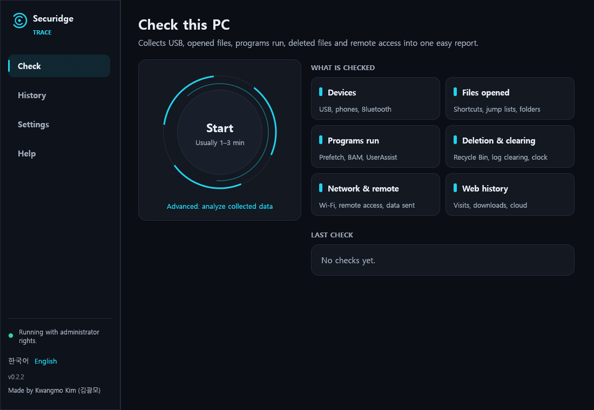
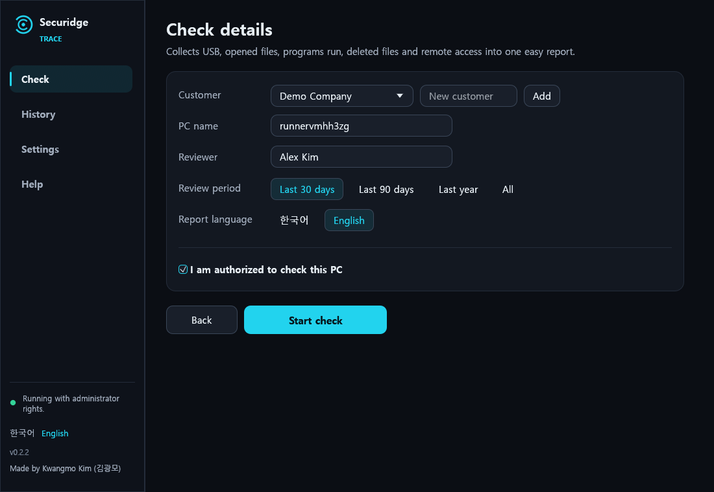
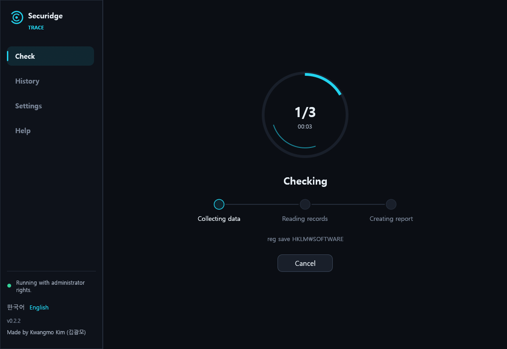
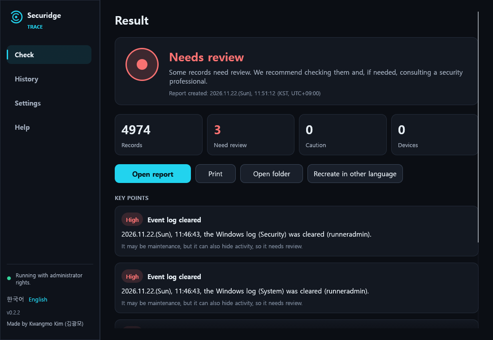
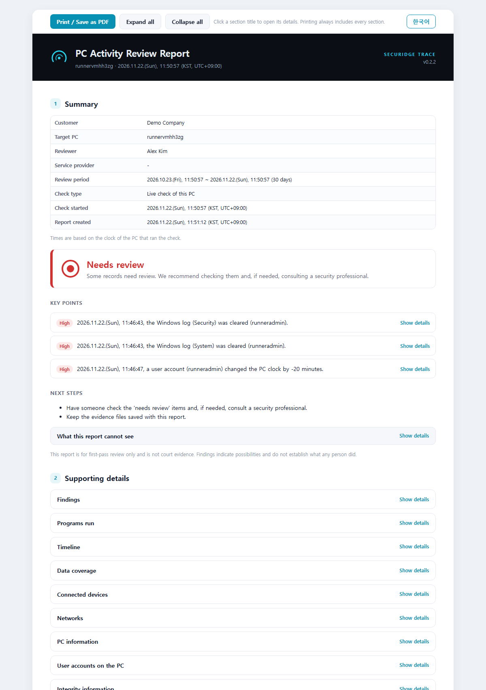

<p align="center"></p>

<h1 align="center">Securidge Trace</h1>

<p align="center">
A free Windows tool that turns the activity traces a PC leaves behind into <b>one report anyone can read</b>.<br>
No installation · English / 한국어 · Open source (MIT OR Apache-2.0)
</p>

<p align="center">
<a href="https://github.com/securidge/securidge-trace/releases/latest/download/SecuridgeTrace-windows-x64.zip"><b>⬇ Download the latest version (Windows x64, zip)</b></a>
&nbsp;·&nbsp; <a href="../../releases/latest">Release notes</a>
&nbsp;·&nbsp; <a href="README.ko.md">한국어</a>
</p>



## What it does

Windows records a lot on its own: which USB drives were plugged in, which files and folders were opened,
which programs ran, what was deleted, which networks and remote sessions were used, and whether logs were
cleared or the clock was changed. Securidge Trace reads those records **read-only**, puts them on one timeline,
applies 13 plain-language rules, and writes a report with one of four results:

**Nothing found · Caution · Needs review · Undetermined (not enough data)**

Each finding cites the record numbers it is based on and says how it could be a false alarm.

## Quick start

1. [Download the zip](https://github.com/securidge/securidge-trace/releases/latest/download/SecuridgeTrace-windows-x64.zip) and unzip it (running it from a USB drive is recommended).
2. Run `SecuridgeTrace.exe` and allow administrator rights (needed to read the registry and event logs).
3. Click the big **Start** ring, confirm the details, tick *I am authorized to check this PC*, and start.
4. After 1–3 minutes, click **Open report**.

| 1. Start | 2. Confirm | 3. Running | 4. Result |
|---|---|---|---|
|  |  |  |  |

**Every check writes the report in both English and Korean**; the button at the top right of the report switches language.
The summary is shown first and every detail section opens with **Show details**, so the page stays calm. Printing always includes everything.

<details><summary>Report example</summary>



</details>

- Integrity: compare the zip with the `.sha256` file next to it (`Get-FileHash file.zip -Algorithm SHA256`).
- The program is not code-signed, so Windows SmartScreen may warn on first run: **More info → Run anyway**.
- Full guide: `Guide-EN.txt` inside the zip.

## What it reads

| Source | What | How (live check of this PC) |
|---|---|---|
| SYSTEM hive | Computer name, time zone, USB storage (first/last connected, removed), portable devices, Bluetooth, drive letters, **BAM** (last run per user) | `reg save`, transaction logs applied |
| SOFTWARE hive | Windows version, accounts (SID ↔ name), networks (wired/wireless, first/last connected) | `reg save` |
| User hives (NTUSER, UsrClass) | **UserAssist** (programs started from Explorer, run counts), **ShellBags** (folders opened, incl. USB/network/phone) | `reg save HKU\<SID>` for logged-on users, otherwise direct |
| **Amcache.hve** | Executables that existed on the PC, path and SHA-1 | `esentutl /y /vss` (shadow copy) |
| **Prefetch** | Programs run, run count, last 8 run times, volume serial of the executable (Windows 7–11, compressed format) | Direct |
| **SRUM** | Network bytes per program per day (about 30 days) | `esentutl /y /vss` |
| Event logs | Log cleared (1102, 104), clock changed (4616, Kernel-General 1), storage connected (1006), Wi-Fi (8001, 8003), **Remote Desktop** (4624 type 10, 21/24/25, 1149) | `wevtutil epl` |
| Shortcuts (LNK), **Jump Lists** | Files opened, volume serial, drive type, per-program recent items | Direct |
| Recycle Bin `$I` | Original path, size, time and account of deleted files | Direct |
| Browsers | Chrome, Edge, Whale, Brave, Vivaldi visits and downloads; Firefox visits | Read from a copy |

**Rules:** R1 new storage device · R2 storage used outside work hours · R3 files opened from removable storage (linked to the device by volume serial) ·
R4 mass deletion · R5 log cleared · R6 clock changed by a person · R7 portable device · R8 cloud / webmail ·
R9 program run from removable storage · R10 anti-forensics tool run · R11 Remote Desktop logon ·
R12 program with large daily upload · R13 remote-control tool run.
Registered devices and the USB that carries the tool are excluded. Thresholds and program-name lists are editable in Settings.

**Limits:** this is a first-pass, reference-only review. *No record* does not mean *no activity*.
It cannot see the names or contents of files sent out, printing, screenshots, or files copied without being opened.

## Validation status

Every push is verified automatically on GitHub Actions Windows virtual machines (Windows Server 2022 and 2025);
results appear as a table in each run's Summary.

| Check | Method | Server 2022 / 2025 | Desktop Windows 10 / 11 |
|---|---|---|---|
| Shortcuts: path (incl. Korean), volume serial, size, open time | Compared with real shortcuts created via the Shell API + 17 public samples | Pass | Not yet |
| Recycle Bin: path, size, deletion time, account | Compared with files actually sent to the Recycle Bin | Pass | Not yet |
| Registry: USB, portable, Bluetooth, drive letters, networks (local→UTC), accounts | Compared with a ground-truth hive made with `reg save` (26 items) | Pass | Not yet |
| Live check: collection, system info, R5 log cleared, R6 clock changed | Logs actually cleared and clock actually changed, then `trace check` | Pass | Not yet |
| User hives, Amcache, SRUM collection; Amcache parsing (4,000+ executables) | Live check | Pass | Not yet |
| BAM device path → drive letter | Live check (`\Device\HarddiskVolumeN` → `C:\…`) | Pass | Not yet |
| Jump Lists, UserAssist | Real records on the VM + public samples (EZ, dtformats) | Pass (parsing) | Not yet |
| Prefetch (Win 7/8/10 formats, decompression) | Run counts, times, volume serials of public samples | Pass (samples); Prefetch is off by default on Server | Not yet |
| SRUM database | Real SRUDB.dat tables (≈900 app-usage rows) | Pass (parsing); the VM has no network-usage rows | Not yet |
| Internal (virtual) disks not counted as USB storage (v0.2.1 fix) | Live demo on the VM | Pass | Not yet |
| ShellBags, Remote Desktop logs, storage/Wi-Fi logs | Unit tests against format documentation | No real records on the VM | Not yet |
| Real USB drives and phones, real browser databases | — | Not possible on a VM | Not yet |
| Rules R1–R13, time formatting, reports, malformed-input robustness | Unit and integration tests | Pass | — |

**Real USB devices and desktop Windows 10/11 still need one manual pass.** Procedure: `docs/test-scenarios.md`.

## Build from source

```
cargo test --workspace
cargo build --release -p st-gui -p st-cli
```
Rust 1.97.0 (`rust-toolchain.toml`). Output: `target/release/SecuridgeTrace.exe` (app) and `trace.exe` (command line).

```
trace check   --i-am-authorized --customer "Company" --analyst "Alex Kim" [--days 30] [--lang en|ko]
trace analyze --input E:\ --output D:\results --case "PC-01"
trace regen   --dir <history folder> --lang ko
```
Exit codes: 0 ok · 2 finished, but some items could not be read or the input changed · 1 could not run.

<details><summary>Repository layout</summary>

```
crates/core      data model, settings, time conversion, hashing, safe byte reading
crates/i18n      English/Korean strings (generated by tools/locales.py), time formatting
crates/collect   finding record files in the input
crates/parsers   hives, event logs, shortcuts, Jump Lists, Prefetch (Xpress Huffman), shell items, SRUM, Recycle Bin, browsers
crates/timeline  turning records into facts on one timeline, linking accounts
crates/rules     correlation, rules, grade
crates/report    case.json, evidence.json, timeline.csv, HTML reports
crates/engine    running a check (incl. live collection), settings, customers, history
crates/gui       desktop app (egui)
crates/cli       command line
assets/          app icon (SVG source, ICO)
ci/              Windows VM validation and demo-capture scripts
docs/            design notes, data model, test procedures
dist/            guides shipped in the zip
```
</details>

## Author

Made by **Kwangmo Kim (김광모)** as a personal project, free for everyone.

## License

MIT OR Apache-2.0 (`LICENSE-MIT`, `LICENSE-APACHE`). Third-party libraries are listed in `THIRD-PARTY-LICENSES.txt` inside the zip.
Test samples: shortcuts from github.com/AbdulRhmanAlfaifi/lnk_parser (MIT); Prefetch and Jump Lists from github.com/EricZimmerman (MIT);
some Jump Lists from github.com/libyal/dtformats (Apache-2.0). Jump List AppID names come from EricZimmerman/JumpList (MIT).
SRUM parsing uses sootmark-srum (MIT/Apache-2.0).
